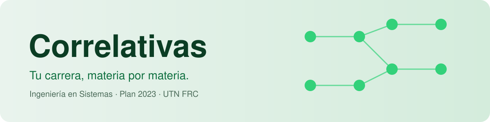
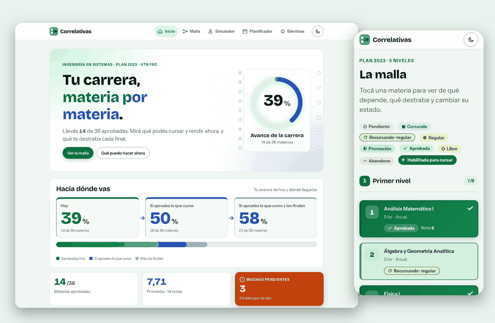
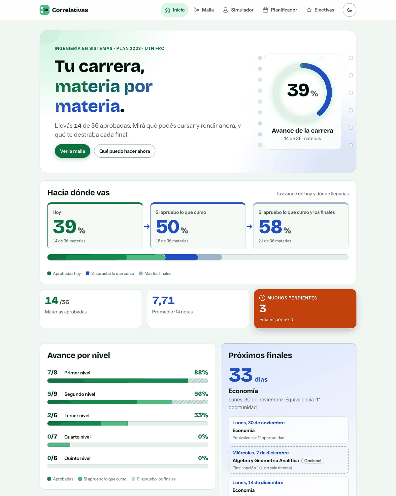
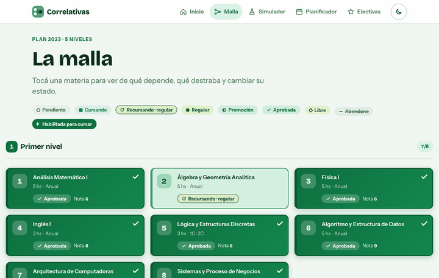
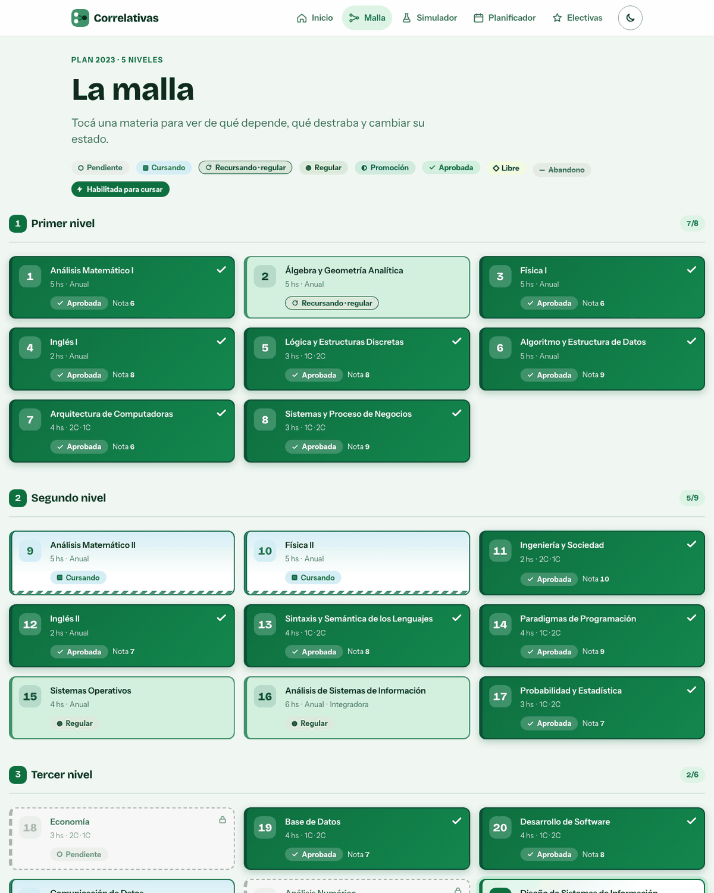
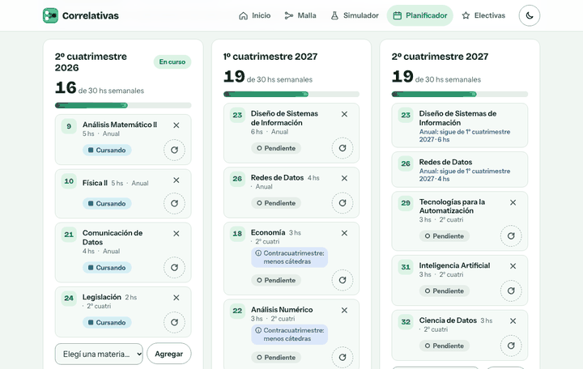
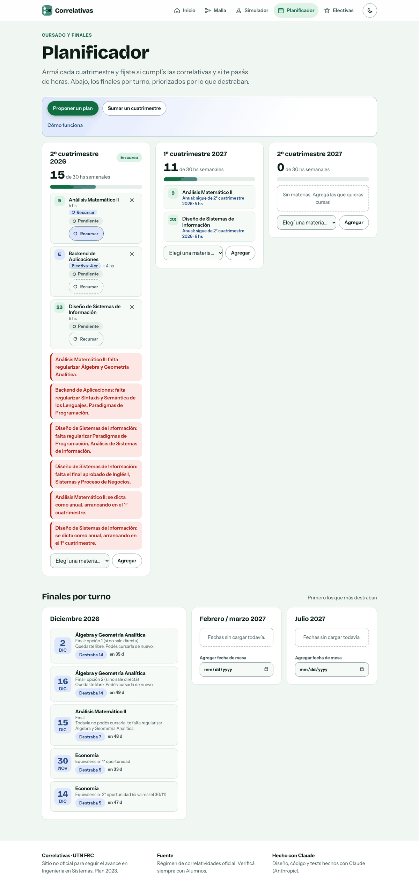
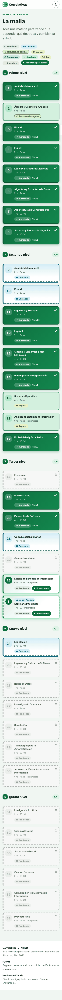
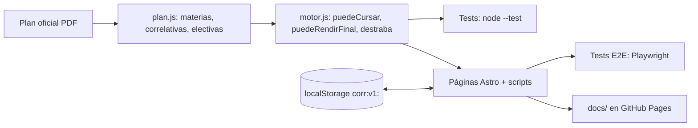

<div align="center">

[](https://claude.com/claude-code)

<picture>
  <source media="(prefers-color-scheme: dark)" srcset="assets/readme/banner-oscuro.svg">
  
</picture>

### Seguí el avance de tu carrera y tus correlativas sin planillas: malla visual, simulador y planificador.

[](https://gabibertero.github.io/mis_correlativas/)


[](https://github.com/gabibertero/mis_correlativas/commits)

[🏠 Inicio](https://gabibertero.github.io/mis_correlativas/) &nbsp;·&nbsp; [🗺️ Malla](https://gabibertero.github.io/mis_correlativas/malla/) &nbsp;·&nbsp; [🧪 Simulador](https://gabibertero.github.io/mis_correlativas/simulador/) &nbsp;·&nbsp; [📅 Planificador](https://gabibertero.github.io/mis_correlativas/planificador/) &nbsp;·&nbsp; [⭐ Electivas](https://gabibertero.github.io/mis_correlativas/electivas/)

<br>

<picture>
  <source media="(prefers-color-scheme: dark)" srcset="assets/readme/mockup-oscuro.png">
  
</picture>

</div>

> [!NOTE]
> Sitio **no oficial** de seguimiento personal. No tiene relación con la UTN ni con Alumnos. Las correlativas salen del plan oficial de Ingeniería en Sistemas de Información (Plan 2023, UTN FRC), pero ante cualquier duda, verificá siempre en el sistema de la facultad.

<details>
<summary><b>📑 Contenido</b></summary>

- [Qué tiene](#-qué-tiene)
- [Cómo usarlo](#-cómo-usarlo)
- [Cómo está hecho](#-cómo-está-hecho)
- [Para desarrollar](#-para-desarrollar)
- [Roadmap](#-roadmap)
- [FAQ](#-faq)
- [Hecho con Claude](#-hecho-con-claude)
- [Créditos y licencia](#-créditos-y-licencia)

</details>

## ✨ Qué tiene

Reemplaza una planilla de Google por una app estática, rápida y pensada para el celular.

| | | | |
|---|---|---|---|
| 📊 **Dashboard** | Avance total y por nivel en 3 tonos, promedio, créditos y cuenta regresiva. | 🗺️ **Malla visual** | Todas las materias con su estado y las correlatividades resaltadas. |
| 🧪 **Simulador "¿y si…?"** | Qué se desbloquea si aprobás X, sin tocar tu estado real. | 📅 **Planificador** | Arrastrá materias y electivas a cuatrimestres, con validación. |
| ⭐ **Electivas** | 19 electivas con créditos, filtros y buscador. | 💾 **Tus datos, tuyos** | Todo en tu navegador, con exportar e importar `.json`. |

<details>
<summary>📊 <b>Dashboard</b>: dónde estás y hacia dónde vas</summary>

<br>

- Avance **hoy**, **si apruebo lo que curso** y **si doy los finales**, en tres tonos de verde.
- Promedio, créditos electivos (20 de Ingeniería, 4 de Analista) y próximos finales ordenados por fecha con cuenta regresiva.
- **Plan propuesto para el próximo año** (1C y 2C) con el porqué de cada materia: qué destraba.

<picture>
  <source media="(prefers-color-scheme: dark)" srcset="assets/readme/hero-oscuro.png">
  
</picture>

</details>

<details>
<summary>🗺️ <b>Malla visual</b>: tocá una materia y mirá qué depende de qué</summary>

<br>

- Estados: aprobada, regular, recursando, cursando, promoción, pendiente, libre y abandono.
- Al tocar una materia se resalta de qué depende y qué habilita (directa e indirectamente).
- Panel para ver qué te falta para cursar o rendir el final, y para cambiar estado y nota.



<picture>
  <source media="(prefers-color-scheme: dark)" srcset="assets/readme/malla-top-oscuro.png">
  
</picture>

</details>

<details>
<summary>📅 <b>Planificador</b>: cursado y finales con validación de correlativas</summary>

<br>

- Arrastrá materias y electivas a cuatrimestres; avisa si no cumplís las correlativas o si te pasás de horas.
- Propuesta automática de plan, priorizando lo que más destraba.
- Finales por turno, ordenados por impacto.



<picture>
  <source media="(prefers-color-scheme: dark)" srcset="assets/readme/planificador-oscuro.png">
  
</picture>

</details>

<details>
<summary>📱 <b>En el celular</b></summary>

<br>

Diseñado desde 390 px, sin scroll horizontal, con navegación inferior.

<picture>
  <source media="(prefers-color-scheme: dark)" srcset="assets/readme/malla-movil-oscuro.png">
  
</picture>

</details>

Además: tema claro/oscuro, animaciones sutiles (reveal al scroll y transición entre páginas, que respetan `prefers-reduced-motion`) y funcionamiento sin JS para lo básico.

## 🧭 Cómo usarlo

1. Abrí el **Inicio** y revisá tu avance.
2. En la **Malla**, tocá cada materia y cargá su estado y nota.
3. Probá en el **Simulador** qué pasa si aprobás ese final que te queda.
4. Armá el próximo año en el **Planificador**.
5. Sumá tus electivas en **Electivas**.
6. Exportá tu estado de vez en cuando.

> [!TIP]
> Para pasar tu progreso de la compu al celular: **Exportar estado** en un dispositivo e **Importar estado** en el otro.

> [!IMPORTANT]
> Tu progreso vive **solo en tu navegador** (`localStorage`, prefijo `corr:v1:`). Si borrás los datos del sitio, se pierde: hacé una exportación.

## 🛠️ Cómo está hecho


Astro genera HTML estático hacia `docs/` (GitHub Pages). El motor de correlatividades es JS puro y testeado, separado de la UI.



<details>
<summary>📁 Estructura de carpetas</summary>

```
github/
├── fuente/                 Proyecto Astro
│   ├── src/
│   │   ├── data/plan.js    Materias, correlativas, electivas, mesas
│   │   ├── lib/            motor.js (reglas), progreso.js (localStorage), vista.js
│   │   ├── scripts/        UI de cada página
│   │   ├── components/ layouts/ pages/ styles/
│   └── tests/              node --test + Playwright
├── docs/                   Build publicado (no editar a mano)
├── assets/readme/          Capturas y banners de este README
├── ESTADO-SITIO.md         Bitácora del proyecto
└── CHANGELOG.md
```

</details>

## 💻 Para desarrollar

**Requisitos:** Node 20 o superior.

```bash
cd fuente
npm install
npm run dev       # servidor local
npm run build     # genera ../docs
npm run preview   # sirve el build
npm test          # tests unitarios (node --test)
npx playwright test --config tests/playwright.config.mjs   # E2E
```

<details>
<summary>➕ Cambiar o agregar datos del plan</summary>

1. Editá `fuente/src/data/plan.js` (materias, `reg` y `aprob`, electivas o fechas de mesas).
2. Las reglas viven en `fuente/src/lib/motor.js`: no se hardcodean en las páginas.
3. Corré `npm test` y `npm run build`.

</details>

## 🗓️ Roadmap

- [x] Dashboard con avance, promedio, créditos y cuenta regresiva
- [x] Malla visual con correlatividades y panel de estado y nota
- [x] Simulador "¿y si…?"
- [x] Planificador con validación y propuesta automática
- [x] Electivas en el planificador y tabla filtrable
- [x] Exportar e importar estado
- [x] Tema claro/oscuro y mobile-first
- [x] Activar GitHub Pages
- [ ] Cargar fechas de mesas de febrero/marzo y julio 2027
- [x] GIFs de demo en este README

## ❓ FAQ

<details>
<summary>¿Es oficial?</summary>

No. Es un proyecto personal de seguimiento, sin vínculo con la UTN.
</details>

<details>
<summary>¿Se guarda mi progreso?</summary>

Sí, en tu navegador (`localStorage`). No hay cuentas ni servidor. Exportá un `.json` como respaldo.
</details>

<details>
<summary>¿Encontré un error en una correlativa?</summary>

Abrí un [issue](https://github.com/gabibertero/mis_correlativas/issues/new/choose) con la materia y qué dice el plan oficial.
</details>

## 🤖 Hecho con Claude

Todo el sitio se hizo con [Claude Code](https://claude.com/claude-code):

- **Diseño:** identidad verde esmeralda, tokens claro/oscuro, malla, Home y animaciones.
- **Código:** páginas Astro, scripts de UI y persistencia.
- **Motor de correlatividades:** reglas de cursar, rendir final y destrabar, con cierre transitivo.
- **Datos:** correlativas verificadas contra el PDF oficial del plan.
- **Tests:** 69 unitarios y 145 E2E.
- **Agentes:** `web`, `disenador`, `estetica`, `tester` y `readme`, orquestados por Gabi.

Los commits llevan `Co-Authored-By: Claude`, por eso Claude figura en Contributors. Revisión y criterio final: Gabi.

## 🤝 Créditos y licencia

Proyecto de [@gabibertero](https://github.com/gabibertero). Licencia [MIT](LICENSE). Ver también [CONTRIBUTING](CONTRIBUTING.md) y [CHANGELOG](CHANGELOG.md).

<div align="center">

<sub>Hecho por <a href="https://github.com/gabibertero">Gabi</a> con <a href="https://claude.com/claude-code">Claude Code</a> 🧉</sub>

</div>
